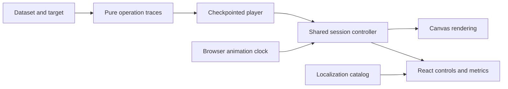

# AlgoVis

**See algorithms execute, step backward through their history, and compare their behavior on the same input.**

`React` · `TypeScript` · `Canvas` · `Vite` · `Playwright` · `English / فارسی`

AlgoVis is an interactive, bilingual sorting and searching visualizer for computer science education. It separates operation traces from playback and rendering, making intermediate states inspectable and reversible.

## Explore algorithms

| Family | Algorithms |
| --- | --- |
| Comparison sorting | Insertion, bubble, selection, merge and quicksort |
| Distribution sorting | Counting and radix sort |
| Searching | Linear and binary search |

- **Explore:** follow one algorithm with pseudocode, narration and complexity.
- **Compare:** run two algorithms on the same input and shared timeline.
- **Playback:** play, pause, rewind, step, scrub and reset.
- **Datasets:** random, sorted, reversed, nearly sorted and duplicate-heavy arrays.
- **Localization:** English/Persian, RTL layouts, localized narration and locally hosted fonts.

## Run locally

Use Node.js 22.12+ and native npm.

```bash
git clone https://github.com/I-Do-CS/AlgoVis.git
cd AlgoVis
npm ci
npm run dev
```

## Architecture



| Path | Responsibility |
| --- | --- |
| src/sorting/ | Sort traces, datasets, playback and session |
| src/searching/ | Search traces |
| src/components/ | Canvas, controls and comparison UI |
| src/hooks/usePlaybackClock.ts | Shared animation clock |
| src/i18n/ | Localization |
| tests/, e2e/ | Model and browser tests |

Checkpoints allow bounded replay during seeking. Binary search operates on an explicitly labeled sorted copy. The displayed playback duration is animation time, not a CPU benchmark.

## Verify and deploy

```bash
npm test
npm run build
npx playwright install chromium
npm run test:e2e
```

The static build is emitted to dist/. See [MILESTONES.md](MILESTONES.md) for implementation history. Font license notices are included in public/fonts/.

Independent, AI-assisted project by [Ali Ghelichkhani](https://github.com/I-Do-CS).
